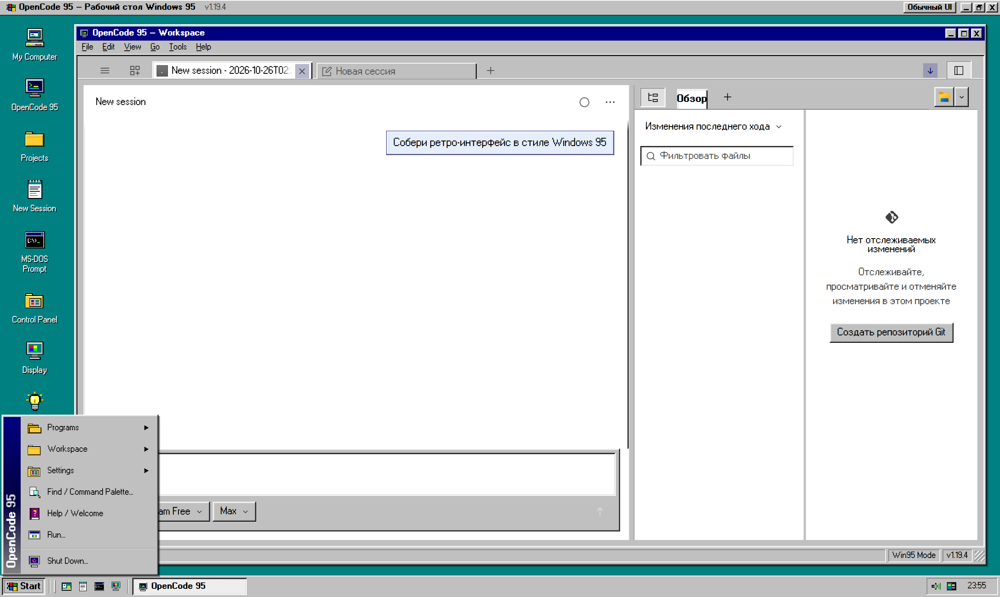
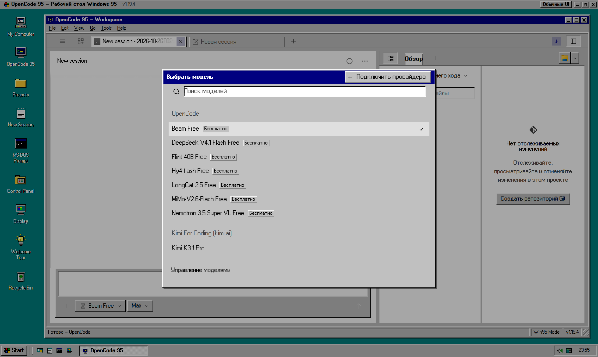

# opencode-win95

Windows 95 desktop theme and shell for OpenCode Desktop (Windows, Electron).

Includes a Windows 95 desktop with icons, framed draggable OpenCode window, taskbar, Start menu, wallpaper and color scheme switcher (Display Properties), Windows 95 WAV sounds, pixel fonts (MS Sans Serif with Cyrillic + Fixedsys Excelsior), and a quick toggle back to the default OpenCode UI.

## Screenshots







## Requirements

- Windows with OpenCode Desktop installed
- Node.js 18+

## Install

```powershell
git clone https://github.com/IvanLindgren/opencode-win95.git
cd opencode-win95
powershell -ExecutionPolicy Bypass -File .\install.ps1
```

What `install.ps1` does:
1. Copies the theme files, fonts, and sounds to `%USERPROFILE%\.config\opencode\win95-theme\`.
2. Backs up the original `app.asar` to `app.asar.bak`.
3. Patches `app.asar` to load the local theme folder.

Start OpenCode Desktop normally after that.

If OpenCode is installed in a custom path:

```powershell
powershell -ExecutionPolicy Bypass -File .\install.ps1 -AsarPath "D:\path\to\resources\app.asar"
```

## Controls

- `Ctrl+Shift+9` or the top bar / tray toggle button: switch between Win95 and the default OpenCode UI without restarting.
- `Ctrl+Esc`: open the Start menu.
- Right-click desktop or double-click `Display`: change wallpapers, color schemes, sounds, and pixel cursor.
- `Ctrl+R`: reload the UI after editing files in `%USERPROFILE%\.config\opencode\win95-theme\`.

## After OpenCode Updates

If an OpenCode Desktop update overwrites `app.asar`, run `.\install.ps1` again (or `%USERPROFILE%\.config\opencode\win95-theme\repatch.ps1`).

## Uninstall

Restore the original `app.asar` from backup:

```powershell
powershell -ExecutionPolicy Bypass -File .\uninstall.ps1
```

Restore `app.asar` and delete the theme folder:

```powershell
powershell -ExecutionPolicy Bypass -File .\uninstall.ps1 -RemoveFiles
```
