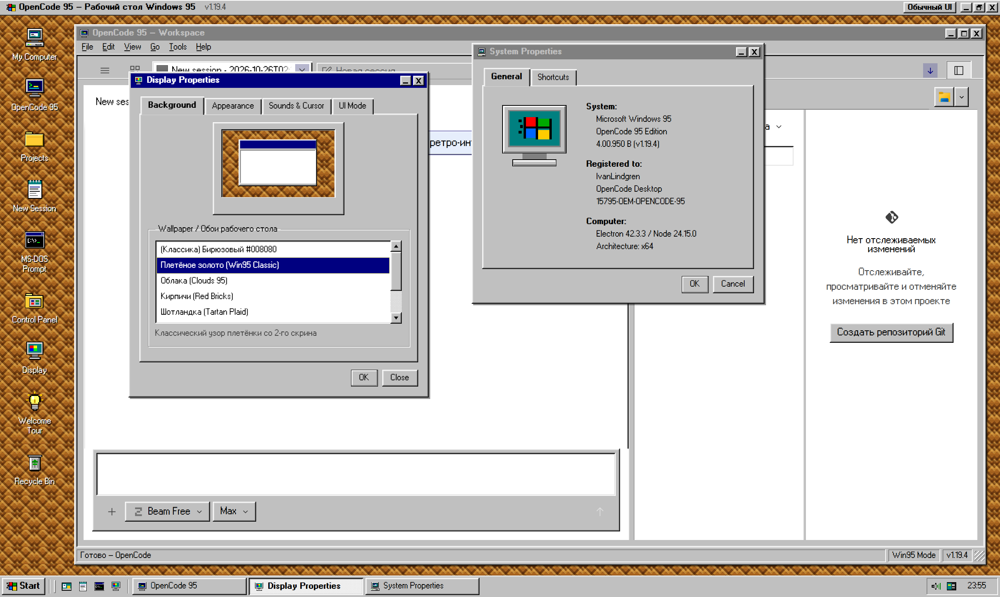
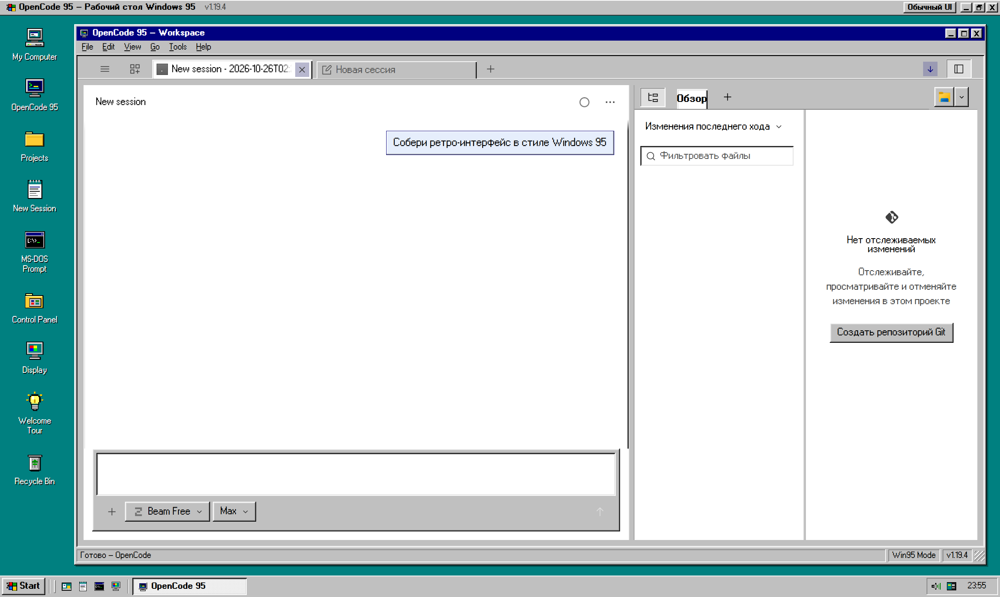

# opencode-win95

Тема и оболочка рабочего стола Windows 95 для OpenCode Desktop (Windows, Electron).

Внутри: рабочий стол с ярлыками, окно OpenCode в рамке Win95, панель задач, меню Start, выбор обоев и цветовых схем (Display Properties), системные звуки Windows 95, пиксельные шрифты (MS Sans Serif с кириллицей и Fixedsys Excelsior) и быстрое переключение обратно на обычный интерфейс.

## Скриншоты







## Требования

- Windows + установленный OpenCode Desktop
- Node.js 18+

## Установка

```powershell
git clone https://github.com/IvanLindgren/opencode-win95.git
cd opencode-win95
powershell -ExecutionPolicy Bypass -File .\install.ps1
```

Скрипт сам:
1. Скопирует файлы темы, шрифты и звуки в `%USERPROFILE%\.config\opencode\win95-theme\`.
2. Сделает бэкап оригинального `app.asar` рядом в `app.asar.bak`.
3. Добавит хук загрузки темы в `app.asar`.

После этого просто запусти OpenCode Desktop.

Если OpenCode установлен в нестандартную папку, передай путь вручную:

```powershell
powershell -ExecutionPolicy Bypass -File .\install.ps1 -AsarPath "D:\path\to\resources\app.asar"
```

## Управление

- `Ctrl+Shift+9` или кнопка в верхней панели / трее: переключить между Win95 и обычным интерфейсом OpenCode без перезапуска.
- `Ctrl+Esc`: открыть меню Start.
- ПКМ по рабочему столу или двойной клик по ярлыку `Display`: сменить обои, цветовую схему, звуки и курсор.
- `Ctrl+R`: перезагрузить интерфейс, если правил файлы в `%USERPROFILE%\.config\opencode\win95-theme\`.

## После обновления OpenCode

Если OpenCode Desktop обновился и перезаписал `app.asar`, снова запусти `.\install.ps1` (или `%USERPROFILE%\.config\opencode\win95-theme\repatch.ps1`).

## Удаление и откат

Вернуть оригинальный `app.asar` из бэкапа:

```powershell
powershell -ExecutionPolicy Bypass -File .\uninstall.ps1
```

Вернуть оригинал и удалить папку темы:

```powershell
powershell -ExecutionPolicy Bypass -File .\uninstall.ps1 -RemoveFiles
```
