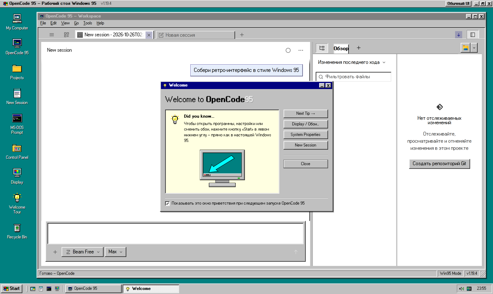

# opencode-win95

Windows 95 desktop theme and shell for OpenCode Desktop (Windows, Electron).

Includes a Windows 95 desktop with icons, framed draggable OpenCode window, taskbar, Start menu, wallpaper and color scheme switcher (Display Properties), Windows 95 WAV sounds (including OpenCode notification sounds), pixel fonts (MS Sans Serif with Cyrillic + Fixedsys Excelsior), update protection, and a quick toggle back to the default OpenCode UI.

## Screenshots




## Requirements

- Windows with OpenCode Desktop installed
- Node.js 18+

## Install

```powershell
git clone https://github.com/IvanLindgren/opencode-win95.git
cd opencode-win95
powershell -ExecutionPolicy Bypass -File .\install.ps1
```

What `install.ps1` does:
1. Copies the theme files, fonts, and sounds to `%USERPROFILE%\.config\opencode\win95-theme\`.
2. Backs up the original `app.asar` to `app.asar.bak`.
3. Patches `app.asar` to load the local theme folder and route OpenCode notification audio to Win95 WAVs.
4. Installs automatic update protection:
   - Updates Desktop and Start Menu `OpenCode` shortcuts to check and re-patch `app.asar` automatically before launch (~15 ms when already patched).
   - Starts a background `FileSystemWatcher` guard (added to Windows Startup, 0% idle CPU) that detects when an OpenCode update overwrites `app.asar`, automatically re-patches the new version, repairs shortcuts, and relaunches OpenCode in Win95 mode.

Optional flags:

```powershell
# Custom app.asar path
powershell -ExecutionPolicy Bypass -File .\install.ps1 -AsarPath "D:\path\to\resources\app.asar"

# Install without the background update guard
powershell -ExecutionPolicy Bypass -File .\install.ps1 -NoGuard

# Also disable OpenCode's auto-updater feed (renames app-update.yml)
powershell -ExecutionPolicy Bypass -File .\install.ps1 -BlockAutoUpdate
```

## Controls

- `Settings -> Appearance -> Theme` (`Windows 95`), `Ctrl+Shift+9`, or the top bar / tray toggle button: switch between Win95 and any built-in OpenCode theme without restarting.
- `Ctrl+Esc`: open the Start menu.
- Right-click desktop or double-click `Display`: change wallpapers, color schemes, sounds, and pixel cursor.
- `Ctrl+R`: reload the UI after editing files in `%USERPROFILE%\.config\opencode\win95-theme\`.

## Uninstall

Stops the update guard, removes it from Startup, restores shortcuts and `app.asar` from backup:

```powershell
powershell -ExecutionPolicy Bypass -File .\uninstall.ps1
```

Restore everything and also delete `%USERPROFILE%\.config\opencode\win95-theme\`:

```powershell
powershell -ExecutionPolicy Bypass -File .\uninstall.ps1 -RemoveFiles
```
